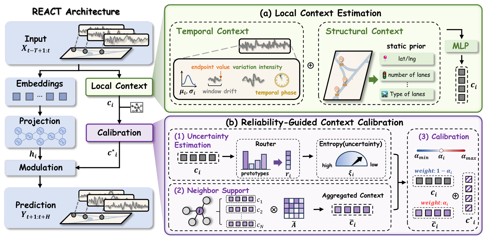
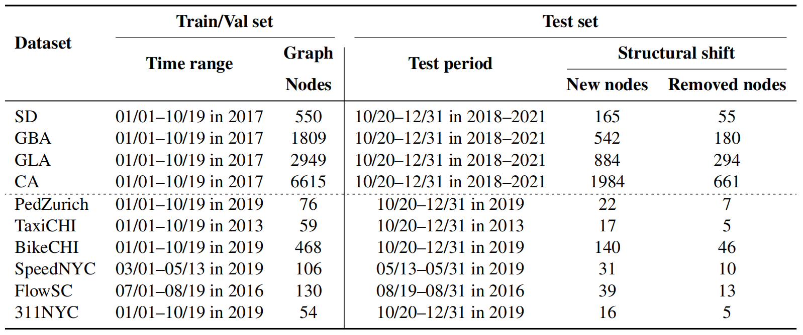

# [NeurIPS'26] REACT

This repository contains the official PyTorch implementation of [REACT](https://nips.cc/virtual/2026/loc/sydney/poster/152742).

## 🧩 Framework

<p align="center">
  
</p>

## 🚀 Getting Started

REACT is evaluated on ten datasets. The table shows the train/validation splits, test periods, and structural shifts.

<p align="center">
  
</p>

For the [LargeST](https://github.com/liuxu77/LargeST) datasets, the data processing follows [STOP](https://github.com/PoorOtterBob/STOP). Download the processed data and put it under `data/`. The placeholder files in `data/sd/` show the expected layout:

```
data/
└── sd/                          
    ├── sd_rn_adj.npy
    ├── sd_meta.csv
    └── 2017/ ... 2021/
        ├── his.npz
        └── idx_train.npy  idx_val.npy  idx_test.npy
```

Then train and evaluate REACT:

```bash
python main.py --dataset sd --protocol main --train_year 2017 --test_years 2018 
```

## 📖 Citation

If you find this repository useful, please cite our paper:

```bibtex
@inproceedings{su2026react,
  title     = {{REACT}: A Lightweight Reliability-Aware Framework for Spatio-Temporal Out-of-Distribution Prediction},
  author    = {Su, Yongfeng and Fang, Ziquan and Yang, Jihua and Shao, Wei and Gao, Yunjun},
  booktitle = {Advances in Neural Information Processing Systems},
  year      = {2026}
}
```

## Acknowledgement

We sincerely thank the authors of [LargeST](https://github.com/liuxu77/LargeST), [ST-OOD](https://github.com/Dreamzz5/ST-OOD) and [STOP](https://github.com/PoorOtterBob/STOP) for making their datasets and code publicly available.

## License

The code is released under the [MIT License](LICENSE).
